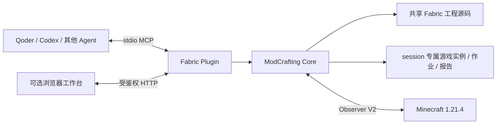

# 架构概览

ModCrafting 的当前产品由一个本地 Node.js MCP 后端、可选浏览器工作台、Minecraft Observer V2 和外部 Agent 组成。旧 Electron/Desktop 程序不属于 `release` 分支。

## 模块职责

| 路径 | 职责 |
|---|---|
| `packages/modcrafting-core/` | Fabric 工程检查、资源准备、session、测试配置、Gradle/游戏任务、Observer、报告与创作工作区逻辑；AI 物品贴图的像素化、质检、候选库与 revision 保存；体素 DSL 解析、贪心网格、图集与模型编译 |
| `packages/modcrafting-view/` | 配方、内容参数、AI 物品贴图、MC 界面、3D 体素模型、构建、游戏、测试及报告页面；按 session 保存草稿 |
| `plugins/modcrafting-fabric/src/mcp-server.ts` | 工具注册和输入校验；将操作委托给 Core |
| `plugins/modcrafting-fabric/src/browser-server.ts` | Token 鉴权、静态工作台服务、按 session 查询和操作 |
| `plugins/modcrafting-fabric/src/workbench.ts` | 本地浏览器打开与链接返回 |
| `bridge-mod/` | Observer V2 的游戏内状态、命令和准备阶段接口 |
| `scripts/plugin/` | 插件构建、验证、Stage、Qoder ZIP 和候选包 |
| `scripts/bench/` | 离线案例集与可选的真实游戏回归 |

## 运行边界

Core 和工作台共享工程源码，但 session 的页面状态、游戏实例、作业、日志和报告相互隔离。所有游戏相关操作都需要 `sessionId`；省略实例时只会选择该 session 的实例。同一工程构建串行，同一工程正在运行的游戏不会被另一 session 抢占。

浏览器链接携带本地后端标识和 Token。页面关闭不停止作业；session 结束只停止该 session 拥有的任务。后端重启后，未结束作业记录为 `interrupted`，保留历史结果但不伪装为仍在运行。

游戏启动准备有独立阶段：准备文件、启动客户端、等待桥接、处理首次向导、准备世界、进入世界、可测试。`bridgeReady` 仅代表 Observer 可通信；测试只有在 `canRunTests=true` 后才可执行。

## AI 物品贴图

宿主 Agent 在同一轮对话内自动完成全流程：调用 `fabric_texture_workspace` 的 `prompt` 获取提示词包，用宿主自己的图像模型生成 PNG，再依次 `import`、`save`，工程已有对应内容对象时 `bind`；用户不需要手动执行每一步。Core 的纯 TS 管线完成背景去除、轮廓扩张、对比度感知降采样、调色板/抖动、二进制 Alpha、描边、材质换色与质量检查；浏览器“贴图”模块只作为可选的逐像素润色和二次优化入口。插件不调用任何图像模型，也不把生成图当作测试通过证据。

保存只写 `assets/<modid>/textures/item/<name>.png`，使用 `expectedRevision` / `previewRevision`、`texture.lock` 和备份；物品纹理引用通过 `bind` 复用 content workspace 的 revision 与生成流程。首版只接受 PNG、支持 16/32/64，保存后必须重新构建并重启客户端；截图只能作为视觉证据，不能自动证明美术质量。候选源图与处理结果保存在 runtime 数据根，每个纹理最多保留 20 个。

## AI 3D 体素模型

宿主 Agent 通过 `fabric_voxel_workspace` 写紧凑的语义体素 DSL（调色板 + RLE 图层 + box 原语），Core 用纯 TS 确定性编译：RLE 展开 → box 原语求值 → 贪心合并 cuboid → block model JSON 与确定性 16px 图集 PNG（噪声着色、1px gutter）→ 1.21.4 物品模型定义。插件不调用任何 3D 生成服务，二次优化（量化、降采样、去悬浮）也在编译管线内完成。

DSL 随 content 对象走 `.modcrafting/content/` 的 revision / 冲突检查 / 备份回滚；图集是受管二进制，外部改写后对象转只读。浏览器“模型”页提供 Three.js 体素画布，用户可旋转、增删体素、调色、镜像与撤销，保存同样走统一 revision 检查；含原语的对象先显式压平为图层。保存后需重新构建并重启客户端，Observer 截图只作视觉证据。

## 构建与打包

`plugin:build` 将 MCP 服务及浏览器资源打成自包含入口。完整候选还需 JDK 21 构建 Observer V2，再由 `product:stage` 和 `host:stage` 生成本地交付包。Qoder ZIP 由 `plugin:qoder` 从候选包中的插件目录生成。此流程不安装宿主插件、不修改账户配置、不创建 GitHub Release。

命令和验证边界见 [命令清单](commands.md)、[Core 接口契约](core-contracts.md) 与 [候选验收](candidate-validation.md)。
